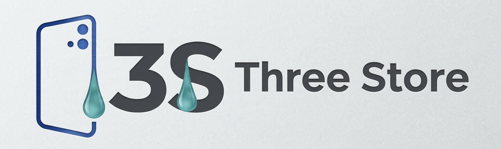

<p align="center">
  
</p># 🛒 Three Store

### 💼 Integrated Store Management System

<p align="center">
  <strong>Manage • Track • Analyze • Grow</strong>
  <br>
  A Complete Desktop Solution for Retail Business Management
</p>

---

## 📌 About The Project

**Three Store** is an integrated desktop-based store management system developed to organize and manage the daily operations of retail businesses through one centralized application.

The system combines sales, purchases, invoicing, inventory, maintenance services, device management, expenses, customer accounts, financial monitoring, and sales analytics in one platform.

It is designed to help store owners and employees manage business operations, monitor financial performance, organize transactions, and make informed business decisions.

---

## ✨ Key Features

### 🛍️ 1. Sales & Purchase Management

A centralized module for managing sales and purchase operations.

* Manage different types of sales transactions.
* Support multiple payment methods, including cash and Vodafone Cash.
* Support credit-based transactions (Deferred Payments).
* Apply manual discounts during sales operations.
* Manage product-related sales and purchases.
* Maintain organized transaction records.

### 📦 2. Products & Inventory Management

A complete product and stock management module.

* Add new products.
* Edit existing product information.
* Delete products.
* Organize products into categories.
* View product details and available quantities.
* Dedicated inventory and stock-taking page.
* Monitor product stock and inventory information.

### 🔧 3. Maintenance Management

A dedicated maintenance system for managing customer devices and repair services.

* Create maintenance invoices.
* Record customer information.
* Record device specifications and condition.
* Track maintenance status.
* Add spare parts to maintenance invoices.
* Edit and manage existing maintenance invoices.
* Handle device delivery operations.
* Maintain maintenance invoice history.
* Maintain a maintenance delivery archive.
* Monitor total maintenance revenue.

### 💻 4. Device Management

A dedicated module for managing devices available for sale.

* Add and manage devices.
* Record device specifications and technical details.
* Track RAM, storage capacity, device type, and condition.
* Record device addition dates.
* Monitor device status.
* Manage device-related operations.
* Track revenue generated from device sales.

### 💰 5. Expense Management

Organize and track daily business expenses.

Examples include:

* Rent.
* Maintenance expenses.
* Water and electricity bills.
* Internet bills.
* Utility expenses.
* Other operational costs.

The system provides date-based filtering to review expenses across different time periods.

### 🔄 6. Returns Management

A dedicated module for handling returned sales and products.

* Manage customer returns.
* Record returned transactions.
* Maintain return records.
* Include returned amounts in financial calculations.

### 🧾 7. Invoice Management

A centralized invoice history for reviewing previously issued invoices.

* Automatically preserve issued invoices in the invoice records.
* Review previous transactions.
* Access invoice details.
* Keep sales records organized.

### 📝 8. Customer Orders Management

A module for recording special customer requests.

* Create customer orders.
* Record requested products.
* Track customer requests.
* Receive notifications related to customer orders.

### 🏷️ 9. Offers & Discounts

A dedicated module for managing promotional offers.

* Add products to promotional offers.
* Configure discounts for selected products.
* Manage product offers.
* Apply discounts through the offers module.
* Support manual discounts during sales operations.

### 💳 10. Credit Management

A dedicated system for tracking customer outstanding balances and deferred payments.

* Track unpaid customer balances.
* Record full or partial payments.
* Update outstanding balances after payments.
* View detailed credit transaction history.
* Access individual customer credit records.
* Monitor deferred payments through a dedicated interface.

### 📊 11. Revenue & Financial Dashboard

A financial management module designed to give store owners a consolidated view of the business's financial performance.

The dashboard includes:

* Sales revenue.
* Total returns.
* Maintenance revenue.
* Device sales revenue.
* Business expenses.
* Overall net revenue.

Net revenue is calculated by combining the different revenue sources, subtracting returns and business expenses, and displaying the resulting financial overview.

The dashboard also provides date-based filtering to review financial performance over selected periods.

### ⚡ 12. Quick Overview Dashboard

In addition to detailed reports and analytics, Three Store provides a separate quick overview dashboard.

This dashboard gives the store owner a fast summary of important business information without having to navigate through every module.

It is designed to provide a convenient overview of the store's operational and financial status.

### ⭐ 13. Favorite Customers

A dedicated feature that automatically identifies and filters preferred customers using the system's customer evaluation algorithm.

This helps the store identify preferred customers and review customer activity.

### 👥 14. User & Role Management

The system supports role-based access control with two main user roles:

**🛡️ Admin / Supervisor**

* Access to administrative functions.
* Manage system members.
* Control available system operations according to permissions.

**👤 Employee**

* Access to employee-specific features.
* Perform assigned daily operations.
* Work within the permissions defined for the employee role.

The Super Admin is responsible for managing system members and their access.

### 📈 15. Sales Reports & Analytics

An analytical module designed to help store owners understand sales performance through data analysis and visualizations.

* Three types of graphical visualizations.
* Mathematical analysis of sales data.
* Explanatory interpretations of business performance.
* Ranking of best-selling products.
* Ranking of best-selling product categories.
* Identification of the most successful sales periods.

These insights help transform transaction records into useful business information.

---

## 🧰 Technology Stack

| Technology                   | Purpose                                    |
| ---------------------------- | ------------------------------------------ |
| C#                           | Application development                    |
| WPF                          | Desktop user interface                     |
| Microsoft SQL Server         | Database management                        |
| SQL Server Management Studio | Database administration                    |
| Visual Studio                | Development environment                    |
| Git & GitHub                 | Version control and source code management |

---

## 🔐 Default Login Credentials

The application currently includes a configured account for initial access.

| Field    | Value    |
| -------- | -------- |
| Username | `Riyad`  |
| Password | `224224` |

> ⚠️ **Security Notice:** These are shared default credentials. Change the password before using the application in a real business environment or making this repository publicly accessible.

---

## 🗄️ Database Setup

The repository includes an empty SQL Server database backup for initial setup.

**Database backup:**

`Database/ThreeStore_Empty_Database.bak`

### Setup Instructions

1. Install Microsoft SQL Server.
2. Open SQL Server Management Studio (SSMS).
3. Connect to your SQL Server instance.
4. Restore the database using the backup file provided in the `Database` folder.
5. Use the database name `StoreDB`.
6. Make sure the database is online and accessible.

### Connection Configuration

The application currently uses a local SQL Server connection.

Open `DatabaseHelper.cs` and update the connection string according to your SQL Server instance:

```csharp
private static readonly string connectionString =
    @"Server=localhost;Database=StoreDB;Trusted_Connection=True;TrustServerCertificate=True;";
```

Replace `localhost` with your SQL Server instance name if necessary.

---

## 🚀 Running the Application

1. Clone or download the repository.
2. Open `WpfApp1.csproj` in Visual Studio.
3. Restore the required NuGet packages.
4. Restore the SQL Server database backup.
5. Configure the database connection string.
6. Build and run the application.

---

## 📁 Project Structure

```text
Three-Store/
│
├── Database/
│   └── ThreeStore_Empty_Database.bak
│
├── Models/
├── Views/
├── Properties/
│
├── App.xaml
├── App.xaml.cs
├── MainWindow.xaml
├── MainWindow.xaml.cs
├── DatabaseHelper.cs
├── WindowManager.cs
├── WpfApp1.csproj
└── README.md
```

---

## 📌 Project Status

Three Store is a practical desktop-based store management system that brings together multiple business operations in one application.

The project may receive further improvements, interface enhancements, and additional features over time.

---

## 👨‍💻 Author

**Riyad Ayman Shoura**

* GitHub: [riy3ddd](https://github.com/riy3ddd)
* LinkedIn: [Riyad Ayman Shoura](https://www.linkedin.com/in/riyad-ayman-771585361/)

---

<p align="center">
  <strong>🛒 Three Store — Manage Your Business in One Place.</strong>
  <br>
  <em>One System. Multiple Operations. Better Business Management.</em>
</p>
